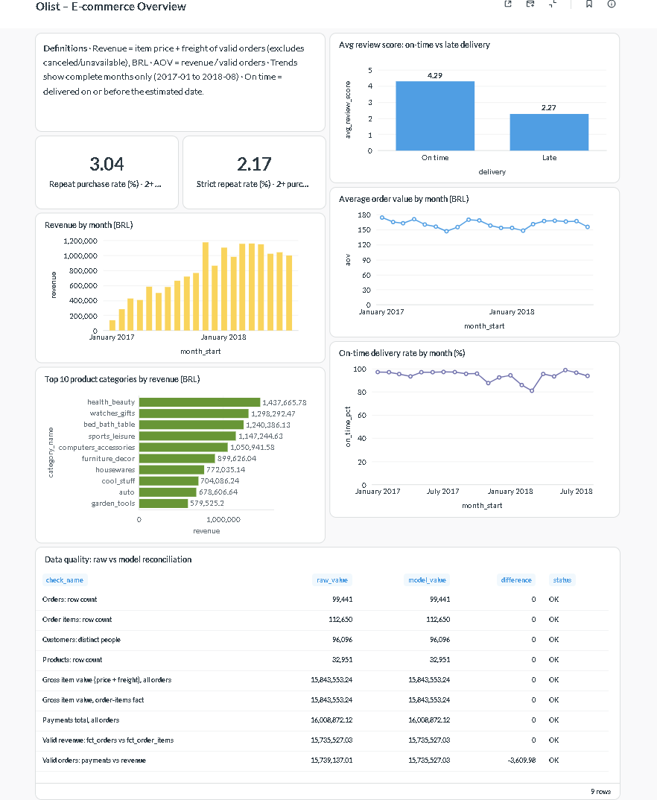

# Olist Mini Analytics Pipeline

A small but complete ELT pipeline on the [Olist Brazilian E-Commerce dataset](https://www.kaggle.com/datasets/olistbr/brazilian-ecommerce):
raw CSVs → **Postgres** (raw layer) → **dbt** (staging → dimensional model → curated metrics, with tests and reconciliation) → **Metabase** dashboard.



---

## 1. Architecture

```
 9 CSV files                       PostgreSQL 16 (Docker)                                   Metabase (Docker)
┌──────────┐   load_raw.py   ┌──────────┐   dbt    ┌───────────┐   dbt   ┌──────────────┐   ┌──────────────────┐
│ data/raw │ ──────────────► │   raw    │ ───────► │  staging  │ ──────► │    marts     │──►│ metrics (curated)│──► dashboard
└──────────┘   (as-is, TEXT) │ 9 tables │  types,  │  9 views  │  facts  │ 2 facts      │   │ 4 tables         │
                             └──────────┘  renames └───────────┘  & dims │ 4 dimensions │   └──────────────────┘
                                                                         └──────┬───────┘
                                                                                └──► reconciliation (raw vs model)
```

| Layer | Schema | Built by | What it contains |
|---|---|---|---|
| Raw | `raw` | `ingestion/load_raw.py` | Exact copy of the 9 CSVs. All columns `TEXT`, plus `_source_file` and `_loaded_at`. |
| Staging | `analytics_staging` | dbt (views) | 1:1 with raw: types cast, columns renamed, typos fixed. No business rules. |
| Marts | `analytics_marts` | dbt (tables) | Dimensional model: `fct_orders`, `fct_order_items`, `dim_customers`, `dim_products`, `dim_sellers`, `dim_date`. |
| Metrics | `analytics_metrics` | dbt (tables) | Curated, business-ready tables that answer the assignment questions. |
| Reconciliation | `analytics_reconciliation` | dbt (table) | Checks that tie the model back to the raw source. |

**Stack:** PostgreSQL 16 · Python 3.11 + psycopg 3 · dbt-core 1.12 + dbt-postgres 1.11 + dbt_utils · Metabase v0.64 · Docker Compose.

## 2. Repository structure

```
├── docker-compose.yml          # Postgres + Metabase
├── requirements.txt            # Python dependencies (dbt, psycopg)
├── run_pipeline.sh             # One command: start DB → load raw → dbt build
├── data/raw/                   # Put the 9 Olist CSVs here (not committed)
├── ingestion/load_raw.py       # ELT "load raw" step
├── dbt/olist_analytics/
│   ├── models/staging/         # stg_*  (+ sources and tests)
│   ├── models/marts/           # fct_* and dim_*  (+ tests)
│   ├── models/metrics/         # mtr_*  (curated answers)
│   ├── models/reconciliation/  # rpt_reconciliation
│   ├── macros/is_valid_sale.sql
│   └── tests/assert_reconciliation_ok.sql
└── dashboard/
    ├── queries/                # SQL behind every dashboard card
    └── docs/dashboard.png      # Dashboard screenshot
```

## 3. How to run it end-to-end

**Prerequisites:** Docker Desktop, Python 3.10+, Git.

```bash
# 1. Clone and enter the project
git clone https://github.com/armandoharo1/olist-mini-analytics-pipeline.git
cd olist-mini-analytics-pipeline

# 2. Download the 9 CSVs from Kaggle and copy them into data/raw/

# 3. Create a virtual environment and install dependencies
python -m venv .venv
source .venv/Scripts/activate        # Windows (Git Bash) | macOS/Linux: source .venv/bin/activate
pip install -r requirements.txt

# 4. Run the whole pipeline (starts Docker, loads raw, builds and tests the dbt project)
bash run_pipeline.sh
```

`run_pipeline.sh` runs these steps (you can also run them one by one):

```bash
docker compose up -d                                   # Postgres (5432) + Metabase (3500)
python ingestion/load_raw.py                           # CSV -> raw schema, row counts checked
cd dbt/olist_analytics && dbt deps && dbt build        # 20 models + 68 tests
```

Expected result: `Done. PASS=88 WARN=0 ERROR=0`.

**Dashboard:** open http://localhost:3500, create a local admin user and add a PostgreSQL database with
host `postgres`, port `5432`, database/user/password `olist`, and restrict schemas to `analytics_metrics`,
`analytics_marts` and `analytics_reconciliation`. The SQL for every card is in `dashboard/queries/`.
Dashboards live in Metabase's own storage (Docker volume), so the screenshot above is the exported version.

> **Windows note:** Metabase is exposed on port **3500** because Windows (Hyper-V/WSL) reserves port ranges
> that may include 3000. If 3500 is also blocked, run `netsh interface ipv4 show excludedportrange protocol=tcp`
> and pick a free port in `docker-compose.yml`.

## 4. Data model

| Model | Grain (one row per…) | Notes |
|---|---|---|
| `fct_orders` | order | Main fact. Items and payments are **aggregated before joining** (avoids fan-out). Revenue, payments, latest review, delivery days, `is_late`. |
| `fct_order_items` | item within an order (`order_id`, `order_item_id`) | Used for category/seller analysis. Keys to all dimensions. |
| `dim_customers` | real person (`customer_unique_id`) | Source `customer_id` is per order; collapsed to one row per person. Location = most recent order. |
| `dim_products` | product | English category; `unknown` if missing; Portuguese name if no translation. |
| `dim_sellers` | seller | |
| `dim_date` | calendar day (2016–2018) | Generated with `generate_series`; makes months without orders visible. |

Both facts keep **every** row from the source and flag business rules with columns (`is_valid_sale`,
`is_delivered`) instead of deleting rows, so they reconcile 1:1 with raw.

## 5. Metric definitions

| Metric | Definition | Table |
|---|---|---|
| Valid sale | Order status not `canceled` and not `unavailable` (orders in progress count). Defined once in `macros/is_valid_sale.sql`. | — |
| Revenue | Σ (item price + freight) of valid orders, by **month of purchase**, BRL. Matches the dataset's "total order value". | `mtr_monthly_sales` |
| AOV | Revenue ÷ number of valid orders with at least one item. | `mtr_monthly_sales` |
| Repeat-purchase rate | % of customers (`customer_unique_id`) with 2+ valid orders. **Strict version:** 2+ different purchase days. | `mtr_repeat_purchase` |
| Top categories | Revenue (price + freight) of valid items per English category, ranked. | `mtr_category_sales` |
| On-time delivery | % of delivered orders delivered on or before the estimated date, by month of purchase; plus average delivery days and review score on-time vs late. | `mtr_delivery_performance` |

Trend charts use **complete months only (2017-01 to 2018-08)**, configured as dbt `vars`. Earlier/later months
exist in the data but have very few orders (the dataset starts/ends there) and are flagged `is_complete_month = false`.

## 6. Validation & reconciliation

* **68 dbt tests**: primary keys (`unique`, `not_null`), composite keys (`dbt_utils.unique_combination_of_columns`),
  accepted values, and `relationships` between every fact and its dimensions (star-schema integrity).
* **`rpt_reconciliation`** compares numbers computed directly from `raw` with the same numbers from the model.
  The singular test `assert_reconciliation_ok` fails the build if any check is out of tolerance.

| Check | Raw | Model | Diff |
|---|---:|---:|---:|
| Orders: row count | 99,441 | 99,441 | 0 |
| Order items: row count | 112,650 | 112,650 | 0 |
| Customers: distinct people | 96,096 | 96,096 | 0 |
| Products: row count | 32,951 | 32,951 | 0 |
| Gross item value (price + freight), all orders | 15,843,553.24 | 15,843,553.24 | 0 |
| Gross item value, order-items fact | 15,843,553.24 | 15,843,553.24 | 0 |
| Payments total, all orders | 16,008,872.12 | 16,008,872.12 | 0 |
| Valid revenue: `fct_orders` vs `fct_order_items` | 15,735,527.03 | 15,735,527.03 | 0 |
| Valid orders: payments vs revenue (tolerance 0.5%) | 15,739,137.01 | 15,735,527.03 | −3,609.98 (−0.02%) |


### Discrepancies found and how they were handled

| Issue | Finding | Handling |
|---|---|---|
| Duplicate reviews | `review_id` is not unique (789 ids repeated); 551 orders have more than one review. | Staging key is (`review_id`, `order_id`); `fct_orders` keeps the most recently answered review per order. |
| Cancellations / unavailable | 1,234 orders; most have no items but were paid (R$ 269.7k of payments vs R$ 108k of items). | Kept in the facts, excluded from revenue via `is_valid_sale`. Refunds are not in the dataset, so payments are not used as revenue. |
| Revenue vs payments | Total payments exceed items + freight by R$ 165k. | For **valid** orders the gap is only R$ 3.6k (0.02%), explained by installment interest/vouchers. Revenue = items + freight. |
| Inconsistent delivery data | 6 canceled orders have a delivery date; 8 delivered orders do not. | "Delivered" = status `delivered` **and** a delivery date. |
| Orders without items | 775 orders (8 of them valid, status `created`/in progress). | Revenue 0 (not NULL); excluded from AOV denominator. |
| Customer identity | `customer_id` changes per order (99,441 ids for 96,096 people). | All customer metrics use `customer_unique_id`. |
| Same-day "repeat" orders | 823 of 2,887 repeat customers placed all their orders on the same day (split checkouts). | Added a strict repeat rate (2+ purchase days): **2.17%** vs 3.04%. |
| Missing categories | 610 products without category; 2 categories without English translation. | `unknown` / Portuguese name fallback in `dim_products`. |
| Nulls | Approval/delivery timestamps missing for undelivered orders; review comments mostly empty. | Kept as NULL; delivery metrics only use delivered orders. |
| Time zones | Source timestamps have no time zone. | Treated as Brazil local time (America/Sao_Paulo), documented, no conversion. |
| Incomplete months | 2016-09 → 2016-12 and 2018-09/10 have very few orders (2016-11 has none). | Kept in tables, flagged, excluded from trend charts. |
| Zip codes | Leading zeros would be lost if parsed as numbers. | Raw loaded as `TEXT`; `lpad(…, 5, '0')` in staging. |

## 7. Results

| Question | Answer |
|---|---|
| (a) Revenue by month | Grows from R$ 137k (Jan-2017) to a R$ 1.0–1.16M/month plateau in 2018. Peak: **Nov-2017 (Black Friday), R$ 1.17M, +53% MoM**. Total valid revenue: **R$ 15.74M**. |
| (b) AOV trend | Stable between **R$ 147 and R$ 174** (R$ 160 over the period): growth came from more orders, not bigger baskets. |
| (c) Repeat-purchase rate | **3.04%** of 94,983 customers (2.17% strict). Very low: retention is the main opportunity. |
| (d) Top categories | `health_beauty` (R$ 1.44M, 9.1%), `watches_gifts`, `bed_bath_table`, `sports_leisure`, `computers_accessories`. Top 10 = 62% of revenue. |
| (e) Delivery | **93.2% on time**, 12.6 days on average. Late deliveries drop the review score from **4.29 to 2.27**. Dips in Nov-2017 (87.6%) and Feb–Mar 2018 (81–86%) follow demand peaks. |

## 8. Key decisions & trade-offs

* **ELT with a faithful raw layer.** Everything is loaded as `TEXT`; typing and cleaning happen in dbt, so any rule can be changed and replayed without re-ingesting.
* **Postgres + dbt + Metabase in Docker.** Easy to reproduce on any machine. DuckDB would be faster to set up, but Metabase support is weaker.
* **Two fact tables with different grains** (order vs order item) instead of one wide table, to avoid double counting.
* **Flags instead of filters** (`is_valid_sale`, `is_delivered`, `is_complete_month`): facts reconcile 1:1 with raw, and business rules live in one place (macro / vars).
* **Revenue = items + freight**, not payments: payments include interest and charges for canceled orders without refund records.
* **Curated metric tables** so the dashboard contains no hidden logic, and every card's SQL is versioned in `dashboard/queries/`.
* **Full refresh** on every run: each raw table is emptied (`TRUNCATE`) and reloaded with `COPY` inside one transaction, so re-runs are idempotent and a failed load keeps the previous data. Tables are not dropped because the dbt staging views depend on them. Simple and fast at this data size (~1.5M rows load in seconds).
* **Geolocation** is loaded and staged but not modeled: none of the requested metrics needed it.

## 9. What I would do with more time

* **Cohort-based retention** (e.g. % of customers who buy again within 90 days): 19% of customers made their first purchase in the last 3 months, which understates the overall repeat rate.
* **Incremental models** (dbt `incremental`) and an orchestrator (Airflow/Dagster) for scheduled loads.
* **Seller and geography analysis**: delivery time by state, seller–customer distance using geolocation.
* **Source freshness and anomaly checks** (`dbt source freshness`, volume/metric thresholds) and CI running `dbt build` on every pull request.
* **Dashboard as code** (Metabase serialization/API) so the dashboard is reproducible from the repo, not only a screenshot.
* **Bonus from the assignment:** a small read-only API/MCP tool answering "what was revenue last month?" from `mtr_monthly_sales`, with parameterized queries only.
